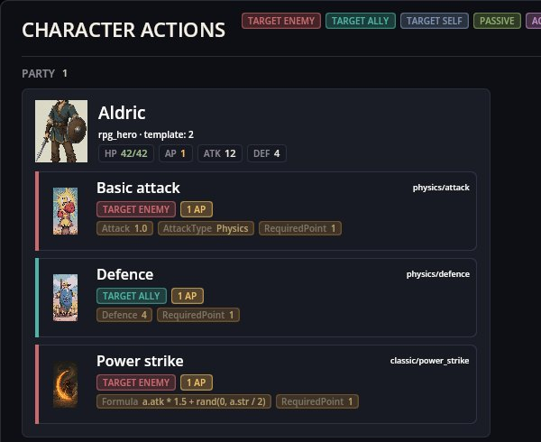

# Characters Editor — sửa nhân vật của mod bằng biểu mẫu

Characters Editor sửa các nhân vật của một mod khi game đang chạy: tên bằng mọi ngôn ngữ của mod, chân dung, sprite đi bộ cho bản đồ RPG, các con số chiến đấu, tỉ lệ chiêu mộ và hành động chiến đấu. **Lưu** ghi các tệp của mod và game dùng thay đổi ngay.

Nó mở từ hộp công cụ (chiếc búa trên thanh công cụ) dưới tên **Nhân vật**.

## Một chỉnh sửa và kết quả trong game

Trong RPG Plus, anh hùng của ngôi làng là nhân vật `rpg_hero` của mod `rpg_demo_game`. Chọn mod đó ở trên, chọn **Anh hùng**, gõ một tên tiếng Anh mới rồi nhấn **Lưu** (Ctrl+S):

Chỉ dòng tiếng Anh trong `locale/en.properties` của mod thay đổi. Ngay sau đó, thành viên tổ đội trên bảng nhân vật:

Bảng hiện HP 42 và ATK 12 trong khi tệp ghi 24 và 6: trong RPG Plus, lớp và chỉ số của anh hùng (Stats Engine với Classic RPG Rules) tính các con số chiến đấu và ghi đè lên giá trị của tệp. Trong game không có chỉ số thì dùng đúng các con số trong tệp.

## Biểu mẫu

- **Id** — id của nhân vật; kịch bản, tổ đội, trận đấu và bản đồ tìm nó qua id này.
- **Tên** — khóa dịch và một dòng cho mỗi ngôn ngữ của mod.
- **Chân dung** — hình trên thẻ và bảng; **…** mở lưới để chọn.
- **Charset (RPG)** — sprite đi bộ trên bản đồ RPG (3 khung × 4 hướng). Trình sửa bản đồ RPG đưa ra các nhân vật kèm charset của họ để đặt.
- **Cấp độ**, **Máu**, **Tấn công**, **Phòng thủ**, **Điểm hành động**, **Kinh nghiệm** — các con số chiến đấu của nhân vật.
- **Tỉ lệ chiêu mộ** — từ 0 đến 100: khả năng thu nhận nhân vật sau khi đánh bại nó (xem Recruiting).
- **Hành vi** và **Hành động** — nhân vật đánh thế nào và có những hành động chiến đấu nào.
- **Trường của mod khác** — các trường mà mod khác mô tả cho nhân vật trong lược đồ của họ (ví dụ lớp, chỉ số và đặc tính của Stats Engine) hiện trong mục riêng.
- **Các trường khác** — phần còn lại của JSON nhân vật, sửa dưới dạng JSON và giữ nguyên như cũ.

Thanh công cụ: **Mới** (Ctrl+N), **Sao chép** (Ctrl+D), **Xóa**, **Hoàn tác**/**Làm lại** (Ctrl+Z / Ctrl+Y), **Lưu** — chỉ những tệp thay đổi được ghi; văn bản vào các tệp bản địa hóa của mod.

## Những nhân vật nào được sửa

Danh sách chứa các nhân vật trong tệp của chính mod được chọn; chỉ có các mod cài dưới dạng thư mục được đưa ra. Nhân vật của mod khác không có trong danh sách và tệp của họ không bao giờ bị ghi. Muốn đổi một nhân vật như vậy, hãy mang cùng id trong mod của mình kèm phụ thuộc vào chủ sở hữu, hoặc thêm trường bằng bản vá.

## Khi có trục trặc

1. **Đổi máu hay tấn công không có tác dụng.** Game tính các con số từ chỉ số, như RPG Plus làm với tổ đội của nó.
2. **Nhân vật không có ở thẻ Nhân vật của trình sửa bản đồ RPG.** Thẻ này liệt kê các nhân vật có chỉ số chiến đấu; sprite nào cũng đặt được từ thẻ Appearance.
3. **Danh sách mod trống.** Mod đóng gói không sửa được.
