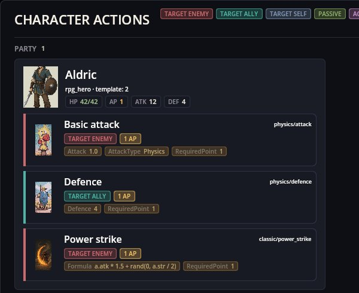

# Characters Editor — 用表单编辑模组的角色

Characters Editor 在游戏运行时编辑模组的角色：各种语言的名称、立绘、RPG 地图的行走图、战斗数值、招募几率和战斗行动。**保存**会写入模组的文件，游戏立刻使用这一变化。

它从工具箱（工具栏上的锤子）打开，叫**角色**。

## 一次编辑及其在游戏中的结果

RPG Plus 里村庄的英雄是模组 `rpg_plus_game` 的角色 `rpg_hero`。顶部选择该模组，选**英雄**，输入新的英文名称，按**保存**（Ctrl+S）：

只有模组 `locale/en.properties` 的英文一行变了。紧接着角色面板上的队伍成员：

面板显示 HP 42 和 ATK 12，而文件里写的是 24 和 6：在 RPG Plus 中，英雄的职业和属性（Stats Engine 与 Classic RPG Rules）会计算战斗数值并覆盖文件里的值。在没有属性的游戏里用的就是文件里的数字。

## 表单

- **Id** —— 角色的 id；剧本、队伍、战斗和地图都靠它找到角色。
- **名称** —— 翻译键和模组每种语言的一行文字。
- **立绘** —— 卡片和面板上的图片；**…** 打开网格挑选。
- **行走图（RPG）** —— 角色在 RPG 地图上的行走图（3 帧 × 4 朝向）。
- **等级**、**生命**、**攻击**、**防御**、**行动点**、**经验** —— 角色的战斗数值。
- **招募几率** —— 0 到 100：击败后收编该角色的几率（见 Recruiting）。
- **行为**和**行动** —— 角色怎么打，以及有哪些战斗行动。
- **其他模组的字段** —— 其他模组在各自模式中为角色描述的字段（例如 Stats Engine 的职业、属性和特性），会在单独区域出现。
- **其他字段** —— 角色 JSON 的其余部分，按 JSON 编辑并原样保留。

工具栏：**新建**（Ctrl+N）、**复制**（Ctrl+D）、**删除**、**撤销**/**重做**（Ctrl+Z / Ctrl+Y）、**保存** —— 只写改动的文件；文字进入模组的本地化文件。

## 其他模组的角色

列表显示所选模组的角色。勾选 **Entries of other mods** 可加入其依赖模组的角色，并标记 `↗ 所有者`。编辑这类角色时，会在你的模组中写入补丁 `patches/character/<你的模组>.json`，只包含你改动的值；所有者的文件逐字节保持不变。**Reset to inherited** 删除补丁，字段旁的 **↺** 删除你对该字段的值。只能写入以文件夹形式安装的模组。

## 队伍区块

表单下方的队伍区块显示两项内容：

- **队长（Party leader）** —— 玩家在 RPG 地图上以其行走图行动的角色。队长是游戏的 `stats.player` 所指的角色；若没有，则是战斗队伍中的第一个角色。该区块会对当前角色显示「Party leader」或「Not the party leader」。目前还没有设置新队长的按钮：这是合集的设置，通过模组管理器修改。
- **计算出的战斗数值** —— 角色有 `Stats` 时，列出每个属性及其战斗数值。提示说明生命、攻击和防御来自属性，因此应编辑属性而不是这些字段。带 `Stats` 的角色，**Health**、**Attack** 和 **Defence** 为只读。没有 `Stats` 时，区块会说明，战斗数值即上方字段的值。
- **对话时加入队伍** — 勾选后写入加入剧本 `scenarios/<你的模组>/party/<id>.scenario`：它把标志 `<id>_joined` 设为 1，并把角色加入队伍（`action party.add`）。取消勾选会立即删除该文件。队长从不加入（复选框已禁用）。要让角色在地图上成为同伴，请在 RPG 地图编辑器的「游戏角色」标签页放置它：与放置的角色对话即可加入，该角色离开原来的格子，同伴跟在主角身后移动。

## 出问题了怎么办

1. **改了生命或攻击没有效果。** 游戏会从属性推算数值，RPG Plus 对自己的队伍就是这样做的。
2. **角色不在 RPG 地图编辑器的调色板中。** 「游戏角色」标签页只列出有行走图（**Charset**）的角色，没有行走图就无法放置。「角色」标签页（Actors）列出的是 `rpg_object` 的 actor 对象，不是游戏里的角色。
3. **模组列表是空的。** 打包模组不能编辑。
